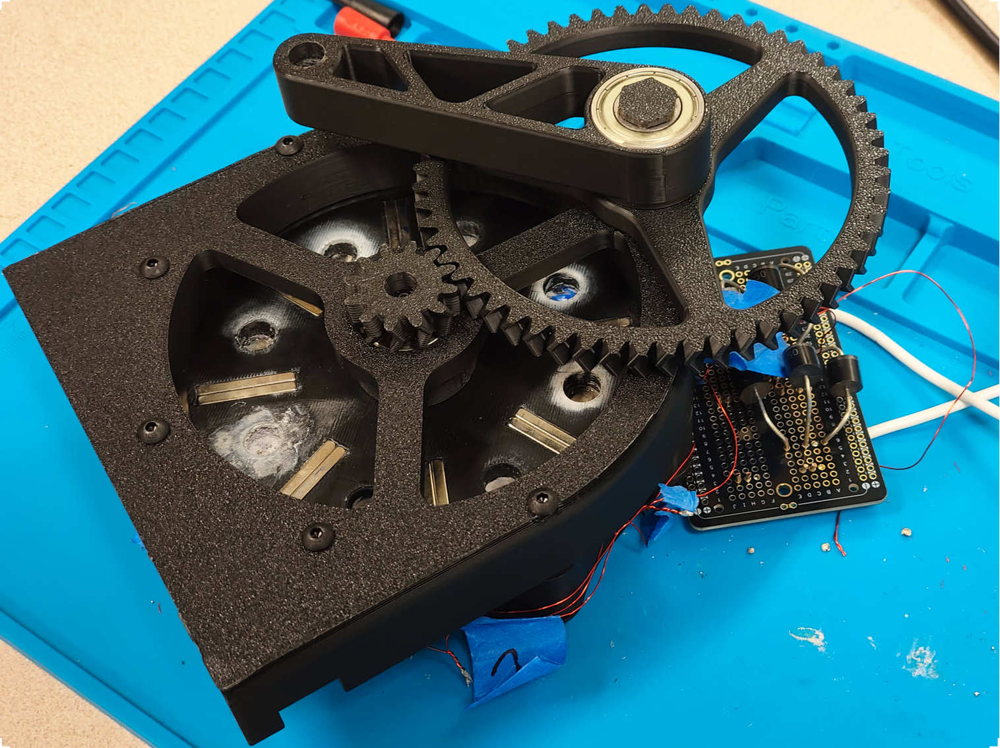
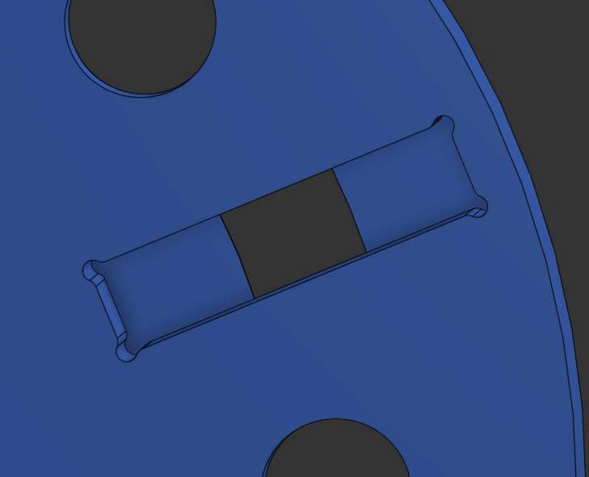

# Axial Flux Generator

Designed and built by Ventura College’s Engineering Society

Project led by Antonio Franco and Wyatt Schmitz

## Specifications

- Single Rotor
- Single Stator
- 12 Coils
- 8 Poles
- 120mm Rotor Diameter

## Goal: Make an alternator from scratch

Axial flux

Halbach array

## Design

The magnets are press fit into the 3D printed rotor and glued in place. To keep a tight fit, dog-bone fillets are used.

