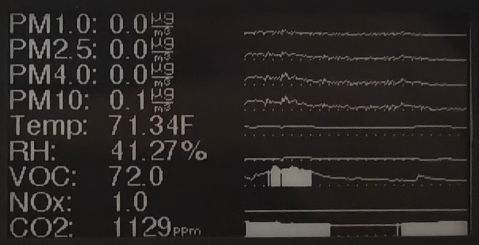

### A bedroom air-quality monitor and data dashboard

Airspace is a connected air monitor I built for my bedroom, which also serves as my workspace. It measures nine air-quality and environmental readings, displays current conditions and recent trends on an e-paper screen, and sends raw measurements to a Raspberry Pi for storage. I designed and 3D-printed a custom enclosure to make the electronics feel at home in a living space.

## At a glance

- **Sensor:** Sensirion SEN66
- **Microcontroller:** Seeed Studio XIAO ESP32C6
- **Display:** 2.66-inch, 296 × 152 monochrome e-paper
- **Data pipeline:** ESP32-C6 → Wi-Fi → Python CRUD server → SQLite on Raspberry Pi
- **Enclosure:** Designed in Onshape and 3D-printed in PLA on a Bambu Lab P1S
- **Status:** Monitor and live dashboard are working; dashboard design and historical comparisons are in progress

## What it measures

The SEN66 provides readings for:

- PM1.0, PM2.5, PM4, and PM10
- Temperature and humidity
- VOC and NOx
- CO₂

## How it works

The ESP32-C6 reads the SEN66 at its maximum measurement frequency of once per second. It sends the raw readings as JSON over HTTP to a Python CRUD server running on a Raspberry Pi, which stores the data in SQLite.

The database has two tables with different purposes:

- A **high-frequency table** stores one-second readings for the most recent 24 hours. I periodically delete older records from this table.
- A **long-term table** stores a reading every ten minutes and is currently retained indefinitely. I may reduce its sampling frequency if the stored history proves more detailed than I need.

The air monitor connects to the Raspberry Pi’s Wi-Fi access point. The ESP32-C6 is powered through its USB-C port.

## E-paper display

The display shows current sensor readings and a separate line graph for each measured quantity, covering the previous 24 hours. Each graph point represents the median of readings from a ten-minute interval. Using medians helps reduce the effect of short-lived spikes and makes the plots more representative of room conditions.

The graph connects the interval medians with lines. One horizontal pixel represents ten minutes, and the area beneath the line is filled when a value falls outside the good-air-quality metrics used by the project. The e-paper refreshes every five minutes; new graph data is added as each ten-minute interval is completed.

I chose monochrome e-paper for the current build. The display is also available in tri-color, so a future version could use its additional color to make poor air quality stand out more clearly.

## Enclosure design

I designed the enclosure in Onshape with both the home setting and practical assembly in mind. It is designed to print as one main component, with two access doors and one separate detail that can be printed in another color for contrast.

The enclosure assembles without screws, fasteners, or other added parts. Dovetails and slots hold the sections together, while flex clips, friction fits, and constrained geometry keep the electronics in place. I also shaped parts of the model to print more reliably and modeled some supports by hand. The SEN66 faces forward, with its inlet and outlet unobstructed.

I printed the enclosure in PLA on a Bambu Lab P1S. PLA was suitable for this indoor application, where the enclosure does not need to withstand high temperatures.

## Firmware and software

The firmware is written in C. Sensirion and Adafruit provide code for using their components; I used AI assistance to adapt that code to work with the ESP32-C6 and the assembled hardware. I wrote the parts of the firmware that analyze, communicate, and display the sensor data.

Getting the e-paper display and Wi-Fi connection working took debugging. Some generated code did not work correctly for this hardware, so I investigated and fixed the issues to get the components communicating reliably.

The live web dashboard reads current values and plots the measured quantities across several graphs. It is functional, but I am still refining its appearance and working on adding comparisons with historical data.

## What I learned

This project brought together sensor integration, embedded C, wireless communication, data handling, visualization, and enclosure design. It also gave me experience reviewing and debugging AI-assisted code rather than treating generated code as a finished solution.
