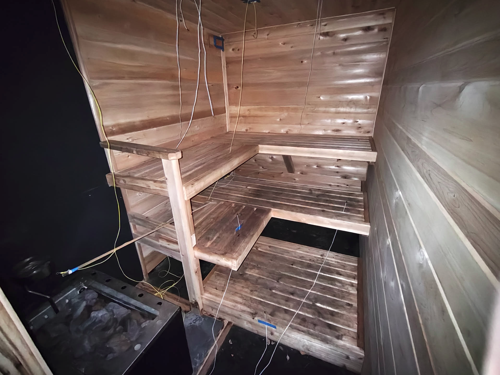
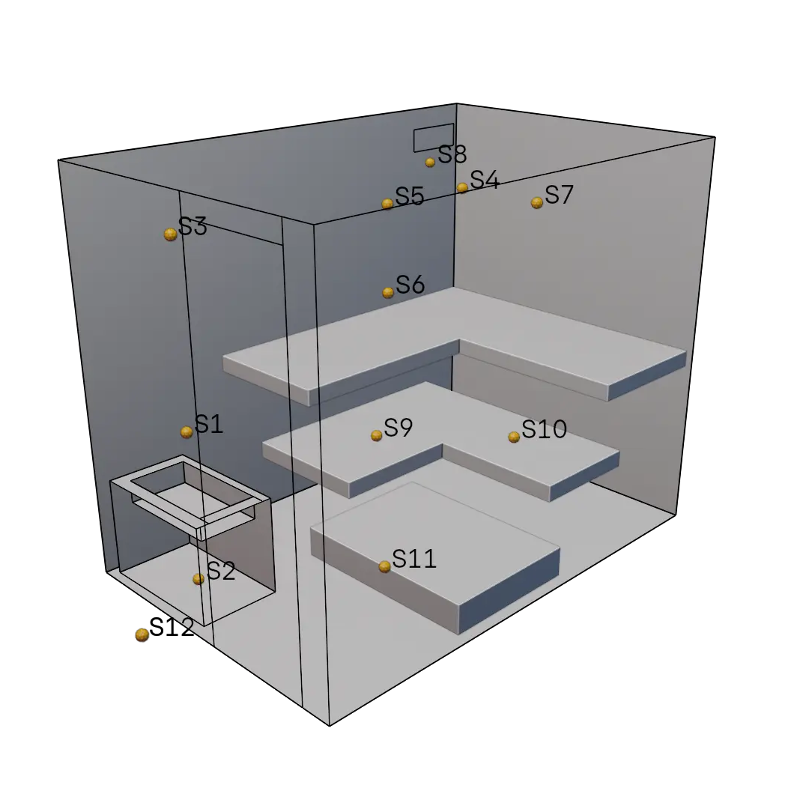
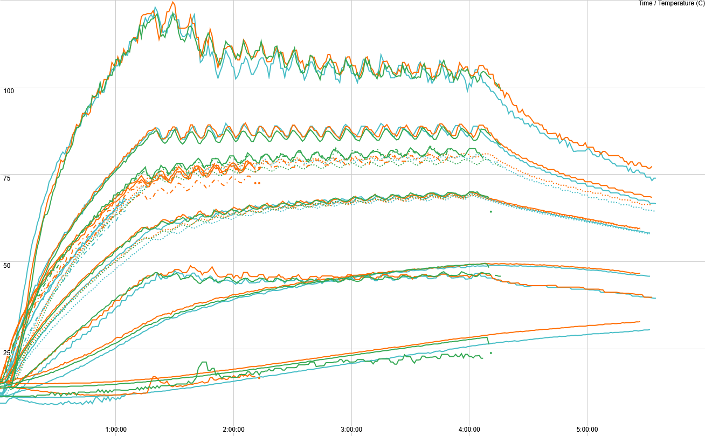

# Lamppa Manufacturing Sauna Data Collection Procedure

Created a multi-point temperature logger inside a sauna to analyze the performance of one of Lamppa's sauna heaters. I placed 10 thermocouple  sensors throughout the hot room to measure the change in temperature while heating the room and holding a constant temperature. Tests were repeated to confirm consistant runs.

3 of the sensors are measuring the heater with one measuring the temperature under the heater where the cold air is pulled in, one a foot above the heater, and one near the ceiling above the heater where the heater measures the temperature to regulate itself.

7 sensors are spread across the benches where people sit. 3 at head level of different places people could sit on the upper bench, 1 at chest level of someone on the upper bench, 2 on the mid level bench, and 1 on the lowest platform.

One sensor was placed in the changing room to measure heat leaking through the door and diving wall, and one sensor was placed outside to determine the effect of outside temperature on hot room heating time.

## Results
The data from the sensors showed a clear temperature gradient throughout the height of the hot room where the floor is $30 \degree C$ cooler than the ceiling. The initial slope shows a consistent heating time of 90 minutes. The oscillations after heating up shows the heater turning on and off every 8-10 minutes to hold the steady temperature for 3 hours before turning off and starting to cool off.

